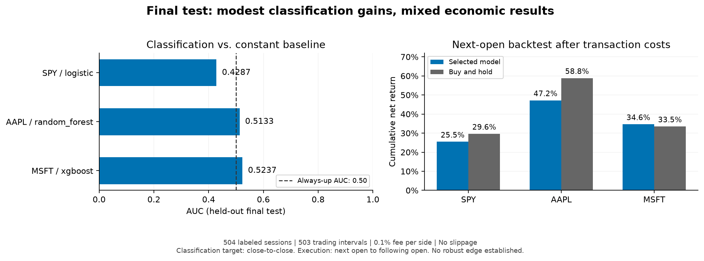

# Stock Movement Predictor

[](https://github.com/joseferdinang/stock-movement-predictor/actions/workflows/tests.yml)


Evaluación honesta de clasificación binaria de la dirección del cierre de mañana. Honest next-session direction classification. Python 3.11, SPY / AAPL / MSFT, sin interfaz web ni trading en vivo.

**Para revisores / For reviewers:** [Notebook ejecutado / Executed notebook](notebooks/results.ipynb) · [Resultados CSV / Results](docs/results/) · [English](#english) · [Resumen para portafolio / Portfolio summary](PORTFOLIO.md).



El test final muestra mejoras pequeñas en AAPL y MSFT y un resultado negativo en SPY. Solo MSFT supera buy and hold después de costos; no se demuestra una ventaja estable.

The final test shows small classification improvements for AAPL and MSFT and a negative result for SPY. Only MSFT beats buy and hold after costs; a robust edge is not established.

## Español

### Hipótesis y resultado principal

Los indicadores técnicos disponibles al cierre podrían aportar discriminación sobre el signo del retorno de la siguiente sesión. La hipótesis se contrasta contra **siempre sube** y **persistencia**; no se presupone rentabilidad.

- **SPY / logistic:** AUC walk-forward 0.5083, AUC final 0.4287; accuracy final 53.37%, diferencia frente a siempre sube -1.59 pp. Retorno final neto 25.46%, buy and hold 29.61%.
- **AAPL / random_forest:** AUC walk-forward 0.5084, AUC final 0.5133; accuracy final 53.77%, diferencia frente a siempre sube +0.40 pp. Retorno final neto 47.17%, buy and hold 58.83%.
- **MSFT / xgboost:** AUC walk-forward 0.5098, AUC final 0.5237; accuracy final 53.37%, diferencia frente a siempre sube +1.19 pp. Retorno final neto 34.62%, buy and hold 33.47%.

3/3 modelos seleccionados alcanzan la meta de accuracy media walk-forward ≥48 %. 2/3 tienen AUC final >0,50. Una AUC ligeramente superior a 0,50 no demuestra significación estadística ni una ventaja operable. Se conservan los incumplimientos y las diferencias negativas, sin ajustar el experimento para eliminarlos.

### Reproducción

Desde la raíz del repositorio, con Python 3.11; instrucciones PowerShell:

```powershell
python -m venv .venv
.\.venv\Scripts\Activate.ps1
python -m pip install -r requirements.txt
python -m pytest -q
python -m jupyter lab notebooks/results.ipynb
```

En Jupyter, seleccionar el kernel del entorno y ejecutar **Restart Kernel and Run All Cells**. El notebook ejecuta carga, controles anti-leakage, selección anidada, evaluación y backtests; conserva tablas y gráficos para revisión sin ejecutar. También puede ejecutarse sin interfaz:

```powershell
python -m jupyter nbconvert --to notebook --execute --inplace --ExecutePreprocessor.timeout=7200 notebooks/results.ipynb
```

La primera ejecución descarga datos y requiere internet; después reutiliza `data/raw/`. No se necesitan claves API. Para renovar la instantánea, cambiar conscientemente `REFRESH_DATA=True` en el notebook; después volver a `False`. La actualización puede revisar los resultados. La reproducción exacta requiere los mismos CSV y hashes; una descarga nueva no garantiza el mismo historial.

### Datos y features

- Fuente: [Yahoo Finance](https://finance.yahoo.com/) mediante [yfinance](https://ranaroussi.github.io/yfinance/reference/api/yfinance.download.html), `auto_adjust=True`, `repair=False`, OHLCV diario. Intervalo solicitado `[2010-01-01, 2026-11-11)`: 4.240 sesiones por ticker, desde 2010-01-04 hasta 2026-11-10.
- Un CSV y un JSON por ticker registran parámetros, versión, momento de descarga y SHA-256. Cambios de parámetros, cachés incompletas, hashes alterados y cobertura insuficiente producen errores explícitos. Se tolera únicamente redondeo numérico de OHLC a escala relativa de `1e-12`; no se reparan precios.
- Target: `int(Close[t+1] > Close[t])`. Empate = 0; última etiqueta = desconocida. Quedan 4.190 observaciones utilizables por ticker: 49 filas iniciales de calentamiento y una etiqueta final desconocida se excluyen.
- Retornos diarios rezagados respecto a mañana: `r_t`, `r_(t-1)`, `r_(t-2)`, `r_(t-4)`, `r_(t-9)` para rezagos 1/2/3/5/10. No son retornos de ventanas acumuladas.
- Distancia porcentual a SMA 5/20/50; desviación estándar muestral de retornos 10/20; RSI de Wilder 14 con semilla SMA; MACD 12/26/9 con señal e histograma; volumen/media móvil de 20 sesiones. Sin imputación ni relleno hacia atrás.

### Metodología

- Modelos separados por ticker. Cinco folds externos expansivos con [TimeSeriesSplit](https://scikit-learn.org/stable/modules/generated/sklearn.model_selection.TimeSeriesSplit.html); tres internos para elegir hiperparámetros por AUC. `gap=1` en ambos niveles y comprobación de que toda etiqueta de entrenamiento se resuelve antes del inicio de evaluación.
- Últimas 504 observaciones etiquetadas reservadas: **2024-11-05 a 2026-11-09**. Una fila adicional se purga en la frontera. Las features del test pueden usar su pasado observado; sus etiquetas no intervienen en entrenamiento.
- Logística con `StandardScaler` dentro de `Pipeline`; árboles sin escalado. Semilla 42, CPU; búsquedas y árboles con `n_jobs=1`. Rejillas pequeñas fijadas antes del test: logística `C={0.1,1,10}`; RF 300 árboles, profundidad `{3,6}`, mínimo de hoja `{10,30}`; XGBoost 150 árboles, profundidad `{2,3}`, tasa `{0.03,0.1}`, subsample y colsample 0,8.
- Elegir familia por AUC externa media; desempatar por accuracy y simplicidad: logística, RF, XGBoost. Reajustar hiperparámetros de la familia elegida mediante validación interna sobre desarrollo. Ajustar el modelo final una vez y congelarlo durante el test. No evaluar retrospectivamente las otras familias para elegir por el test.
- Umbral fijo 0,50. AUC sobre probabilidades; accuracy, precision, recall y matriz de confusión. Media y desviación entre folds, más conteos agregados, en el [notebook ejecutado](notebooks/results.ipynb). La desviación entre folds **no es un intervalo de confianza**. Una AUC indefinida no se oculta al promediar.
- Baselines: siempre sube (probabilidad constante 1; AUC 0,50 con ambas clases) y persistencia (dirección entre el cierre anterior y el de hoy, conocida antes de predecir mañana).
- Accuracy ≥48 % y AUC >0,50 son metas empíricas. Un incumplimiento inicia revisión y se publica como resultado negativo si los controles pasan. Toda accuracy >60 % en cualquier fold o test, incluso de un baseline, queda registrada y auditada. Esta ejecución contiene **0 alertas**; los controles técnicos sobre la instantánea fija pasaron.

### Resultados walk-forward

Todas las familias y ambos baselines; en negrita, familia elegida antes del test final. Métricas por fold, desviaciones y matrices completas en el notebook.

| Ticker | Modelo / baseline | Accuracy media | AUC media |
| --- | --- | ---: | ---: |
| SPY | always_up | 55.11% | 0.5000 |
| SPY | **logistic** | 52.48% | 0.5083 |
| SPY | persistence | 48.86% | 0.4824 |
| SPY | random_forest | 53.84% | 0.4995 |
| SPY | xgboost | 51.79% | 0.4954 |
| AAPL | always_up | 52.61% | 0.5000 |
| AAPL | logistic | 50.62% | 0.4887 |
| AAPL | persistence | 49.19% | 0.4902 |
| AAPL | **random_forest** | 51.07% | 0.5084 |
| AAPL | xgboost | 50.81% | 0.5019 |
| MSFT | always_up | 52.87% | 0.5000 |
| MSFT | logistic | 50.59% | 0.5069 |
| MSFT | persistence | 48.24% | 0.4794 |
| MSFT | random_forest | 50.75% | 0.5037 |
| MSFT | **xgboost** | 50.94% | 0.5098 |

### Test final reservado

| Ticker | Modelo / baseline | Accuracy | AUC | Precision | Recall |
| --- | --- | ---: | ---: | ---: | ---: |
| SPY | logistic | 53.37% | 0.4287 | 0.5437 | 0.9422 |
| SPY | always_up | 54.96% | 0.5000 | 0.5496 | 1.0000 |
| SPY | persistence | 50.99% | 0.5049 | 0.5540 | 0.5560 |
| AAPL | random_forest | 53.77% | 0.5133 | 0.5411 | 0.8810 |
| AAPL | always_up | 53.37% | 0.5000 | 0.5337 | 1.0000 |
| AAPL | persistence | 49.40% | 0.4916 | 0.5259 | 0.5279 |
| MSFT | xgboost | 53.37% | 0.5237 | 0.5398 | 0.7224 |
| MSFT | always_up | 52.18% | 0.5000 | 0.5218 | 1.0000 |
| MSFT | persistence | 48.61% | 0.4850 | 0.5076 | 0.5095 |

Diferencias de accuracy del modelo elegido, en **puntos porcentuales**:

| Ticker | CV vs siempre sube | CV vs persistencia | Final vs siempre sube | Final vs persistencia |
| --- | ---: | ---: | ---: | ---: |
| SPY | -2.64 | +3.62 | -1.59 | +2.38 |
| AAPL | -1.53 | +1.89 | +0.40 | +4.37 |
| MSFT | -1.92 | +2.70 | +1.19 | +4.76 |

### Backtest con costos

Señal de cierre `t` → operación en `Open[t+1]` → rendimiento hasta `Open[t+2]`. El objetivo de clasificación es cierre a cierre: **no coincide con el retorno operado**. Posición long/cash, capital inicial 1, sin apalancamiento ni interés sobre efectivo. Comisión del 0,1 % sobre cada nominal comprado o vendido; no se cobra por mantener. En compra, nominal = efectivo/(1+fee); en venta, efectivo = nominal×(1−fee). Se incluye liquidación final.

Comparaciones por etapa sobre fechas idénticas. El test tiene 504 predicciones, pero 503 intervalos operables: se excluye la última señal por falta de una segunda apertura futura. Buy and hold paga entrada y salida; siempre sube produce exactamente la misma curva. Sharpe anualiza con √252, tasa libre de riesgo cero y desviación muestral de retornos netos. Sin varianza, Sharpe es indefinido. Drawdown sobre capital inicial y valoraciones discretas en apertura; no mide mínimos intradía.

**Test final**, resultados netos; el notebook también muestra desarrollo walk-forward por separado:

| Ticker | Estrategia | Retorno neto | Sharpe | Max drawdown | Operaciones por lado |
| --- | --- | ---: | ---: | ---: | ---: |
| SPY | logistic | 25.46% | 0.823 | -18.23% | 34 |
| SPY | always_up | 29.61% | 0.851 | -19.77% | 2 |
| SPY | persistence | -27.83% | -1.474 | -30.29% | 248 |
| SPY | buy_hold | 29.61% | 0.851 | -19.77% | 2 |
| AAPL | random_forest | 47.17% | 0.807 | -33.05% | 74 |
| AAPL | always_up | 58.83% | 0.910 | -33.33% | 2 |
| AAPL | persistence | -11.61% | -0.257 | -29.35% | 254 |
| AAPL | buy_hold | 58.83% | 0.910 | -33.33% | 2 |
| MSFT | xgboost | 34.62% | 0.724 | -27.39% | 138 |
| MSFT | always_up | 33.47% | 0.630 | -35.16% | 2 |
| MSFT | persistence | -26.97% | -0.567 | -35.43% | 258 |
| MSFT | buy_hold | 33.47% | 0.630 | -35.16% | 2 |

### Pruebas y trazabilidad

**41 pruebas aprobadas**: descarga simulada y caché; OHLCV inválido; rezagos, target, RSI y extremos; invariancia de prefijos al truncar y alterar el futuro; límites de etiquetas; aislamiento del test final; filas usadas realmente para ajustar el escalador; costos y ejecución manuales; integración de las tres familias sin red. Los datos artificiales solo se usan en tests.

`data/processed/` se regenera con predicciones individuales, métricas, particiones internas/externas, parámetros, auditorías, curvas y `experiment_manifest.json` con versiones y hashes. Datos descargados, resultados regenerables y entornos se excluyen de Git; las salidas ejecutadas del notebook y este README sí se versionan. [docs/results/](docs/results/) conserva una instantánea pública de métricas, auditorías y metadatos de la ejecución documentada; no se utiliza como entrada para entrenar ni evaluar. El historial conserva los commits de implementación con autor técnico `Codex <codex@localhost>`.

GitHub Actions ejecuta las 41 pruebas sin descargar cotizaciones y valida el notebook guardado en Python 3.11 sobre Linux y Windows. No reentrena el experimento ni modifica el test final. El estado de cada ejecución se consulta en [Actions](https://github.com/joseferdinang/stock-movement-predictor/actions).

```text
data/raw/          CSV y metadatos de descarga (caché local)
data/processed/    Resultados regenerables y manifiesto
src/data.py        Descarga y validación
src/features.py    Features causales, target y auditoría
src/models.py      Pipelines y validación temporal anidada
src/backtest.py    Ejecución próxima apertura y costos
tests/             Pruebas unitarias e integración
notebooks/         results.ipynb ejecutado
requirements.txt   Versiones verificadas; Python 3.11
docs/              Vista previa y métricas publicadas de esta instantánea
.github/workflows/ Pruebas automáticas en Linux y Windows
```

### Limitaciones

1. Yahoo puede revisar datos y aplicar ajustes retrospectivos por dividendos y splits. Esta instantánea **no es point-in-time**. El test de prefijos verifica el código sobre un CSV fijo, no la disponibilidad histórica de cada dato ajustado.
2. Tres activos elegidos hoy no representan todo el mercado: sesgo de selección y supervivencia. Dependencia temporal, cambios de régimen y tamaño finito de muestra limitan generalización.
3. Seleccionar familias por resultados de desarrollo introduce optimismo allí. El test final reduce ese problema, pero cambiar decisiones tras observarlo consumiría su independencia. No se realizaron pruebas de significación ni intervalos de confianza.
4. Spread, slippage, impacto de mercado, impuestos, rendimiento de efectivo y restricciones de negociación no están modelados. El precio de apertura se asume disponible sin impacto. Las métricas de riesgo usan aperturas discretas.
5. El backtest usa un retorno distinto del target y precios ajustados. La comisión es una hipótesis fija, no una tarifa real de un broker. Este experimento no demuestra rentabilidad futura ni ejecución real.

## English

### Purpose and reproducibility

Predict whether tomorrow's close exceeds today's close, with honest out-of-sample evaluation rather than inflated accuracy. Run the PowerShell commands above with Python 3.11, install `requirements.txt`, then execute all cells in `notebooks/results.ipynb`. The notebook includes saved tables and figures. Initial download requires internet; subsequent runs reuse the verified CSV cache. Exact reproduction requires the same snapshots and SHA-256 hashes because Yahoo may revise history. Synthetic data are used only in tests.

### Method and results

Separate models for SPY, AAPL and MSFT: logistic regression, Random Forest and XGBoost. Five expanding outer folds, three temporal inner folds, and a one-session gap at every boundary. The last 504 labeled sessions are held out, with one extra purged boundary row. Scaling is fitted inside each logistic-regression pipeline. Small predefined grids, seed 42, fixed 0.50 decision threshold, no test-based tuning. Select the family by mean outer AUC, breaking ties by accuracy and simplicity; evaluate only the selected family and both baselines on the untouched final test.

The tables above report **all families** in development, the selected family and **always up / persistence** baselines on the final test, signed accuracy differences in percentage points, and net backtest performance. Negative differences remain visible. Fold dispersion is not a confidence interval. In this run, 3/3 selected models meet the 48% mean walk-forward accuracy goal and 2/3 exceed final AUC 0.50; this is not evidence of statistical significance or a tradable edge.

Features use information through today's close: single-day lagged returns relative to the predicted session (1/2/3/5/10), distances to SMA 5/20/50, rolling volatility 10/20, Wilder RSI 14, MACD 12/26/9 and relative volume 20. Tomorrow's unknown final label is never converted to class zero. Automated tests truncate or alter future rows and verify that earlier features remain unchanged. Accuracy above 60% triggers a documented audit; 0 alerts were recorded. All fixed-snapshot technical checks passed.

### Economic assumptions and limitations

Signals execute at the **next open** and earn returns until the following open; this differs from the close-to-close classification target. Long/cash only, no leverage, cash earns zero, 0.1% fee per purchase/sale including final liquidation. Holding incurs no repeated fee. All strategies share the same dates, including transaction costs for buy and hold. The final backtest contains 503 intervals after trimming one unobservable signal. Sharpe uses net interval returns, 252 sessions and zero risk-free rate; zero variance gives undefined Sharpe. Drawdown includes initial capital and discrete opening valuations, not intraday lows.

Historical adjustments and revisions mean these data are not genuinely point-in-time. Prefix tests verify code causality on a frozen snapshot, not historical data availability. Asset selection/survivorship, serial dependence, regime changes, finite samples and model-selection optimism remain. No confidence intervals or significance tests are claimed. Spread, slippage, market impact, taxes, cash yield and execution constraints are omitted. Adjusted opening prices and a fixed fee are research assumptions. These results do not establish future profitability or live-trading readiness.

**Validation:** 41 passing tests, including all three classifier families, final-test isolation, scaler-fit boundaries and manually checked transaction costs. The notebook was executed top-to-bottom; raw hashes, versions, predictions, split manifests and audits are saved locally under `data/processed/`. No web UI, deployment, neural networks, news data or live trading are included.

The [published result snapshot](docs/results/) contains readable CSV metrics, audits and source hashes for the documented run, without redistributing raw quotes. It is not used as training or evaluation input. GitHub Actions runs the offline test suite and validates the saved notebook on Python 3.11, Linux and Windows; it does not download market data or retune the experiment.
